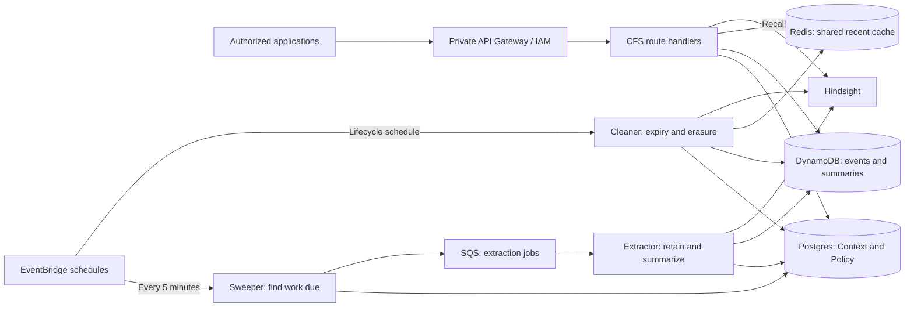
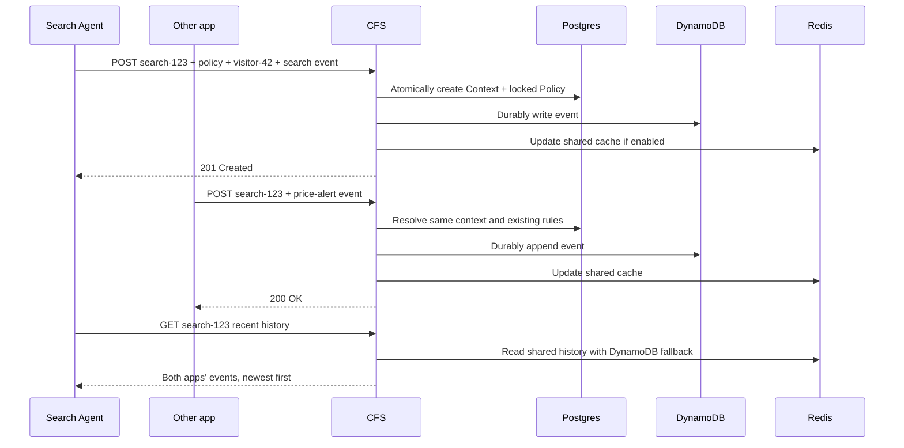
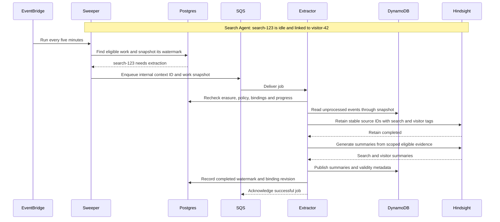
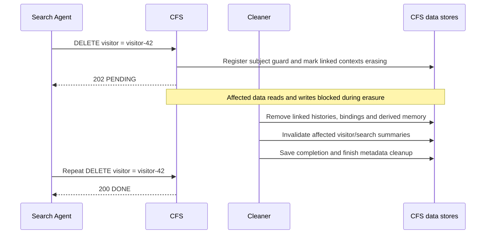

# Context Factory Service — design for signoff

**Design proposal · 2026-10-22.** CFS provides shared context and long-term memory for agentic applications. This document presents the end-to-end design. Supporting references: [Policy](policy.md), [Data-Model](data-model.md), [API](apis.md), [Search-Agent example](examples.md), and [OpenAPI](openapi.yaml).

## 1. Purpose and boundaries

CFS gives authorized applications a shared event history and long-term memory organized around business identities. Applications working on the same business activity contribute to one context. Related contexts can contribute to a common subject's memory, giving agents continuity across workflows.

CFS owns identity binding, retention, access, and processing coordination. Hindsight supplies semantic memory processing. Application-specific workflows and event schemas remain with the applications. The architecture and contract are generic; the sequence diagrams illustrate the Search Agent use case.

## 2. Context identity and policy

**A context is unique by `(tenantId, refLabel, refId)`.** The label names a business subject; the ID identifies one instance. Each application can encounter many IDs under the same label. Multiple authorized applications using the same tuple share one context, regardless of which application created it.

| Contract element | Meaning and ownership |
| --- | --- |
| `refLabel` / `refId` | Caller-supplied business identity, reused by collaborating applications. |
| Request `ltm` | Additional labels mapped to actual identity values supplied by the caller's identity integrations. |
| `policy.ltm` | The same labels mapped to retention and summary rules, supplied on context creation. |
| Internal `ctxId` | Deterministic hash computed by CFS from the tenant/label/value tuple; unchanged by additional writers or bindings. |

Specifically, `ctxId = "c_" + first32hex(SHA256(UTF8(tenantId + "|" + refLabel + "|" + refId)))`. It excludes application identity, LTM bindings, and policy settings. The [Data-Model](data-model.md#ctxid-derivation-and-creation) defines validation, creation, and collision handling.

The first `POST /cfs/v1/contexts` must include an event and a complete policy. CFS creates a Context row containing the business identity and bindings, plus a Policy row containing the rules, atomically in Postgres. Every context receives its own policy copy. Policy ownership is established through creation permissions; the business owner and grants still require agreement.

The policy is immutable. Later writers may omit it; an optionally repeated policy must match. An application cannot apply private rules to the shared context or create a hidden second context by sending different rules. There is no policy PATCH. No public `appId` or separate LTM identifier is needed. See [policy creation](policy.md#2-how-it-is-created) and [stored fields](data-model.md#2-postgres-authoritative-metadata).

CFS derives the context's own LTM identity from `refLabel` / `refId`. Additional values come only from top-level request `ltm`, never from fields inside `data`. Known bindings are inherited when omitted. An unset, policy-permitted binding may be added later; replacing an established value conflicts, and an unconfigured label is rejected. None of these changes creates another context. See [binding rules](apis.md#shared-context-and-binding-rules).

## 3. Shared history and memory scopes

| Read | Result |
| --- | --- |
| `GET /contexts` | One directly keyed context's recent raw events from all writers. |
| `GET /summaries` | One precomputed overall or rolling-window summary for a subject. |
| `GET /memories` | Query-relevant facts/observations for a subject. |

The latter two can aggregate eligible evidence across contexts linked to the same identity; raw-context reads do not fan out across linked contexts. Applications select which authorized scopes to read. Every event contributes to all configured, bound, eligible scopes of its context. Ignoring a summary does not exclude an application's events from it. Event-level exclusions and per-writer streams are outside this proposal.

Applications may write different event shapes; the policy governs grouping and lifetimes, not payload fields. A writer need not know every configured identity. The CFS Extractor generates shared summaries. Access to one shared context does not automatically grant access to every linked subject: CFS authorizes the authenticated principal for the tenant, subject, and operation.

Summary reads distinguish `READY`, `PENDING`, and `EMPTY`; dependency failure returns `503` rather than successful emptiness. LTM may lag raw history. See the [read contracts](apis.md#6-get-summaries--precomputed-ltm).

## 4. Architecture and Hindsight mapping

Postgres stores identity bindings, immutable rules, and work state. DynamoDB durably stores events and precomputed summaries. Redis accelerates shared recent-history reads. The **Sweeper** selects due work; SQS dispatches it to the **Extractor**, which retains evidence in Hindsight and publishes summaries. The **Cleaner** coordinates expiry and erasure.

Candidate Hindsight layout: one bank per tenant. A bank is a storage/isolation container; tags select parallel subject scopes within it. One event can contribute to multiple scopes, and multiple contexts can contribute to the same scope. These are not nested memory banks.

CFS creates internal `label:value` tags from the stored identity/bindings, the locked policy's labels, and each source event's eligibility. Callers supply neither tags nor bank IDs. `per_tag` consolidation builds independent observations per identity. Window selection does not create another identity tag. Bank layout and lifecycle enforcement require validation. See [tag derivation](data-model.md#how-cfs-derives-tags) and [Hindsight scopes](https://hindsight.vectorize.io/developer/api/retain#observation_scopes).

## 5. Create, append, and read

**Search Agent sequence:** the agent creates `search-123`, bound to `visitor-42`. Another authorized app adds a price-alert event to that same search. Both read the combined history. The [demonstration](examples.md) contains complete request bodies.

Each successful POST appends an event. A repeated request can append another event; duplicate suppression is outside the current contract. See [write behavior](apis.md#3-post-contexts--create-or-append).

Postgres and DynamoDB are separate commits; recovery must reconcile partial failures. No successful write depends on a cache update succeeding. Concurrent creation, commit ordering, and stale-result protection are covered in the [Data-Model](data-model.md#7-reads-failures-and-erasure).

## 6. Asynchronous LTM processing

LTM processing is driven by CFS rather than a summary-read request. Every five minutes, the Sweeper checks non-erasing contexts with LTM enabled against their locked policy and processing state.

| Work due | Selection condition |
| --- | --- |
| New events | No write for 30 minutes, or pending work has waited six hours despite ongoing writes. |
| Binding repair | A previously extracted context has an unreconciled binding revision. |
| Summary refresh/invalidation | A window or retention deadline is due, even without new writes. |

These timings are proposed settings, not latency guarantees. Initial bindings are processed with the first event extraction under the idle/backstop rules. Later binding changes on a previously extracted context trigger repair without another idle wait. Contexts already processed through their latest event and binding revision are not repeatedly extracted unless summary work is due.

**Search Agent sequence:** writes to `search-123` stop at 10:12. It becomes idle at 10:42 and can be queued at the next sweep. Another search bound to `visitor-42` is processed independently and contributes to the same visitor memory.

Jobs carry internal `{ctxId, upTo, bindingRevision, reason}`. The Extractor rechecks state, processes all writers' committed evidence through the snapshot, and reconciles bindings. Stable source IDs and progress checks support retries. Checkpoints advance only after required work succeeds; publication fencing must prevent stale results, including when several contexts update the same subject. SQS retries failures and sends exhausted work to a dead-letter queue.

A late binding backfills only recoverable eligible STM/LTM evidence. Deleted history cannot be restored, and an unbound label's TTL does not reserve a historical copy. Summary-only work can reuse retained evidence without retaining unchanged events again. See [worker state and lifecycle](data-model.md#6-sweeper-extractor-and-lifecycle).

## 7. Retention, windows, and erasure

TTL governs retention; windows select recent evidence for a summary. Each configured key has its own TTL and optional windows. Proposed output includes an overall summary plus configured rolling windows. `P7D` means the preceding seven days; `P30D` means thirty days, rather than a calendar month.

Proposed clocks: raw-event and per-key LTM expiry start at each event's CFS `recordedAt`; windows use source `occurredAt`, falling back to recorded time. Later activity does not renew older evidence. A shared subject preserves each contribution's expiry and uses the union of windows across active contributions; one context's policy does not rewrite another's.

Rolling summaries need refresh/invalidation as evidence ages out, including when none remains. Strict windows must exclude older source evidence and derived observations; Hindsight temporal ranking alone does not enforce that boundary. Independent key expiry must preserve still-eligible scopes. See [lifecycle requirements](data-model.md#6-sweeper-extractor-and-lifecycle) and [Hindsight temporal semantics](https://hindsight.vectorize.io/developer/api/recall#temporal_window).

**Search Agent sequence:** an authorized visitor-erasure request removes the visitor's linked searches and derived evidence across all contributing applications.

The Cleaner coordinates cleanup across Postgres, DynamoDB, Redis, and Hindsight, invalidating other affected subjects' summaries while leaving unrelated contexts intact. Proposed behavior blocks affected data reads and writes during cleanup. Completion is recorded independently before Context/Policy removal so polling remains meaningful. See [erasure](apis.md#8-delete-contexts--erasure-and-polling).

Ordinary evidence expiry does not reset the locked policy. The proposed default retains compact Context/Policy metadata for later appends. Finite metadata retirement and subsequent identity recreation still need agreement.

## 8. Decisions and implementation gates

**For design signoff:** shared context identity and all-writer reads; mandatory immutable policy; `refLabel` / `refId` / `ltm`; per-key TTLs/windows; and context-wide contributions. Confirm the business owner and principals permitted to create the first policy.

**Proposed details:** TTL/window clocks, late-binding recovery, overall-plus-window summaries, shared-subject reconciliation, metadata retirement, and blocking affected data reads during erasure. Erasure completion retention, reopening an erased identity, and deletion deadlines also require agreement.

**Before implementation commitment:** select the cross-store handoff/repair and publication-fencing protocols. Pin a Hindsight version and prove independent-scope expiry, strict rolling windows, late-binding repair, and complete derived-memory erasure. Benchmark representative bank sizes and worker freshness. If one multi-tag copy cannot enforce lifetimes, change the internal materialization/bank layout while preserving the public contract.

[OpenAPI](openapi.yaml) is a validated contract draft. [Policy](policy.md) defines configuration, [Data-Model](data-model.md) details storage and failure handling, and [API](apis.md) defines caller behavior. Backend guarantees require implementation validation.
